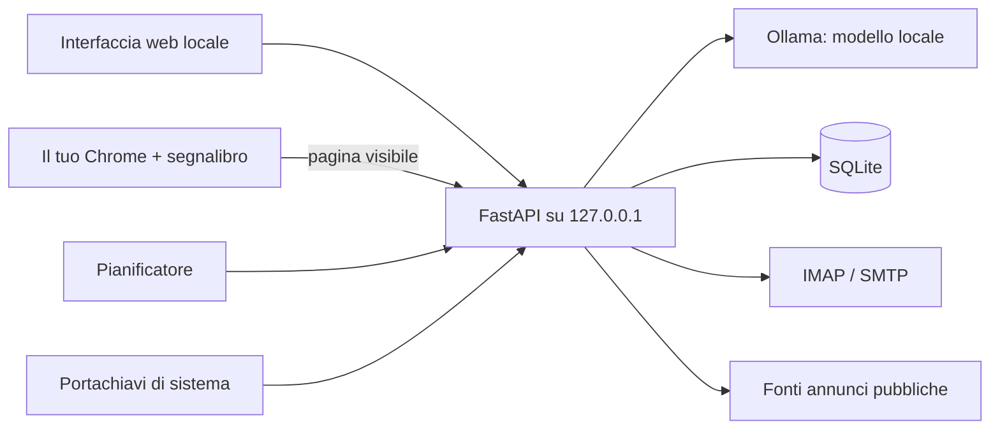

# 💼 Agente Lavoro — collaboratore AI locale per freelance e sviluppatori

> Un'app desktop che ogni giorno cerca opportunità di lavoro e potenziali clienti, legge la posta, prepara le risposte e organizza la giornata. L'AI gira **sul tuo computer**: nessun messaggio parte senza il tuo OK.

    

---

## Cosa fa
| Area | Funzioni |
|---|---|
| 💼 **Opportunità di lavoro** | Annunci da Remote OK, Remotive, Himalayas, We Work Remotely, Arbeitnow e dalle tue ricerche LinkedIn/Indeed; punteggio 1–10 motivato; segnalazione degli annunci sospetti; bozza di candidatura per i migliori |
| 🏢 **Clienti PMI** | Aziende per settore e città da fonti pubbliche, analisi del sito, proposta personalizzata in bozza; limite giornaliero e opt-out |
| 📬 **Posta** | Lettura IMAP in sola lettura, classificazione per priorità, allarmi su IBAN/pagamenti/richieste di password, bozza di risposta |
| ✍️ **Da approvare** | Ogni messaggio passa da *Modifica → Approva → Invia*; in alternativa viene copiato nelle Bozze della casella |
| 📈 **Pipeline** | Nuovo → Contattato → Risposta → Call → Preventivo/Colloquio → Trattativa → Vinto/Perso, follow-up (max 2), export Excel |
| 💬 **Assistente** | Chat con l'AI locale che conosce i dati dell'app |
| 📦 **Progetti GitHub** | Inventario dei progetti, scansione dei segreti, generazione di vetrine pubbliche senza codice proprietario |
| ⏰ **Routine** | Report del mattino e della sera, controllo posta e annunci a orari configurabili |

### ⭐ Il tuo browser, non un browser finto
LinkedIn, Indeed e il gestionale si usano dal **tuo Chrome**, con gli accessi che hai già. L'app apre le pagine lì; un segnalibro (**⭐ Invia ad Agente Lavoro**) passa all'app la pagina che stai guardando: lista di annunci, singolo annuncio o tabella di lead. Nessuna password o cookie viene letto, nessuna automazione nascosta sui portali.

## Architettura


## Sicurezza e privacy
- **Server solo locale** (`127.0.0.1`), protetto da token di sessione.
- **Credenziali** nel Portachiavi di macOS / Gestore credenziali di Windows: mai su file, mai al modello AI, mai nei log.
- **Email, annunci e pagine web sono dati, non istruzioni**: i contenuti esterni vengono isolati prima di arrivare all'AI e i segnali di manipolazione o truffa vengono marcati.
- Controlli **deterministici** nel codice (non nel prompt): limite di contatti giornalieri, blocco opt-out, approvazione obbligatoria.
- AI locale via Ollama: nessun dato inviato a servizi AI esterni.

## Requisiti
- macOS (anche Intel) o Windows 11
- Python 3.11+
- [Ollama](https://ollama.com) — il modello configurato (predefinito `qwen3:4b`) viene scaricato automaticamente al primo avvio
- Google Chrome

## Avvio rapido (macOS)
```bash
bash scripts/installa_e_avvia_mac.sh   # prima volta: installa Python 3.12 se manca, crea .venv-mac e avvia
bash scripts/avvia_mac.sh              # volte successive
```
L'app si apre su `http://127.0.0.1:8000`.

## Avvio (Windows)
```powershell
py -3.11 -m venv .venv
.venv\Scripts\python -m pip install -r requirements.txt
.venv\Scripts\python -m app.main
```

## Test
```bash
python -m unittest discover -s tests -v
```

## Struttura
```
app/core      configurazione, database, client AI, sicurezza, credenziali
app/modules   lavoro, PMI, posta, bozze, pipeline, portali, ponte con Chrome, progetti, report
app/ui        interfaccia web (HTML/JS/CSS, senza build)
scripts/      avvio macOS, diagnostica, inventario progetti, scansione segreti, vetrine
build/        build .app/.dmg (macOS) e .exe (Windows)
```

---
Sviluppato da **Gaspare Pettinati** — [gasparepettinati.it](https://gasparepettinati.it) · info@gasparepettinati.it
