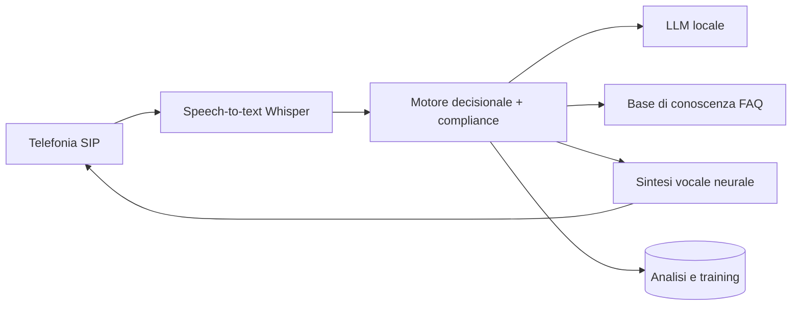

# 🎙️ Agente vocale AI per la vendita di luce e gas

> Un agente telefonico che parla in italiano, spiega le offerte con trasparenza e passa la chiamata a un operatore quando serve. Tutto self-hosted.

**Contesto:** realizzato per un operatore italiano del mercato libero luce e gas (nome omesso per riservatezza) · **Ruolo:** analisi, progettazione e sviluppo · **Codice:** privato

---

## Il problema
Le chiamate commerciali nel settore energia sono tante, ripetitive e molto regolamentate: l'operatore deve presentarsi correttamente, spiegare PUN/PSV e costi obbligatori senza promettere risparmi certi e rispettare chi non vuole essere ricontattato.

## La soluzione
- **Conversazione vocale in italiano**: riconoscimento del parlato (Whisper) e voce sintetica naturale con più motori TTS selezionabili.
- **Motore decisionale** che guida la chiamata: presentazione, qualifica (casa/business, luce/gas/dual), spiegazione dell'offerta, gestione delle obiezioni.
- **Regole di compliance nel codice**: dichiarazione dell'identità, nessuna promessa di risparmio certo, chiusura cortese e blocco dei ricontatti su rifiuto.
- **Base di conoscenza** sulle domande frequenti (bolletta, POD/PDR, recesso, firma digitale, volture e subentri).
- **Apprendimento controllato**: le conversazioni vengono valutate e gli esempi approvati migliorano le risposte.
- Dashboard di analisi e training; test automatici su dialoghi, STT e instradamento TTS.

## Architettura (semplificata)

## Stack
| Livello | Tecnologie |
|---|---|
| Backend | Python, FastAPI, Pydantic |
| Voce | faster-whisper, TTS neurali (XTTS, Kokoro, ElevenLabs opzionale) |
| AI | LLM locali via Ollama, motore decisionale a regole |
| Qualità | pytest su dialoghi, decisioni, STT e TTS |

---
### Perché il codice non è pubblico
Il software è in uso in azienda e tratta dati di clienti reali: codice, configurazioni e dati restano privati.
Questa pagina descrive cosa fa e come è costruito. Demo con **dati fittizi** su appuntamento; codice visionabile in **screen-share** o dopo **NDA**.

**Vuoi una soluzione simile per la tua azienda?** Scrivimi: analizzo il processo e propongo una versione su misura.

**Contatti:** [gasparepettinati.it](https://gasparepettinati.it) · info@gasparepettinati.it

© 2026 Gaspare Pettinati — Tutti i diritti riservati. Vedi [LICENSE](LICENSE).
