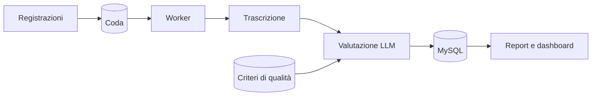

# 🎧 Controllo qualità delle chiamate con AI

> Trascrive le telefonate del call center e le valuta automaticamente rispetto ai criteri di qualità dell'azienda.

**Contesto:** realizzato per un operatore italiano del mercato libero luce e gas (nome omesso per riservatezza) · **Ruolo:** analisi, progettazione e sviluppo · **Codice:** privato

---

## Il problema
Nei call center il controllo qualità si fa ascoltando a campione poche chiamate: lento, costoso e soggettivo. Le chiamate critiche (per esempio i ripensamenti dei clienti) emergono troppo tardi.

## La soluzione
- **Caricamento e importazione massiva** delle registrazioni e delle trascrizioni.
- **Trascrizione automatica** e **valutazione con LLM** sui criteri di qualità definiti dall'azienda: punteggio, motivazioni, anomalie.
- **Code di lavoro asincrone** con più worker: l'interfaccia resta reattiva anche con migliaia di chiamate.
- Report per operatore, **ricerca semantica** nelle conversazioni, notifiche.
- Ruoli, autenticazione a due fattori (TOTP) e **audit log**.

## Architettura (semplificata)

## Stack
| Livello | Tecnologie |
|---|---|
| Applicazione | PHP, Laravel, architettura MVC |
| Dati | MySQL, SQLite per indici locali |
| AI | Server LLM esterno per trascrizione e valutazione |
| Sicurezza | TOTP, ruoli, audit log |

---
### Perché il codice non è pubblico
Il software è in uso in azienda e tratta dati di clienti reali: codice, configurazioni e dati restano privati.
Questa pagina descrive cosa fa e come è costruito. Demo con **dati fittizi** su appuntamento; codice visionabile in **screen-share** o dopo **NDA**.

**Vuoi una soluzione simile per la tua azienda?** Scrivimi: analizzo il processo e propongo una versione su misura.

**Contatti:** [gasparepettinati.it](https://gasparepettinati.it) · info@gasparepettinati.it

© 2026 Gaspare Pettinati — Tutti i diritti riservati. Vedi [LICENSE](LICENSE).
