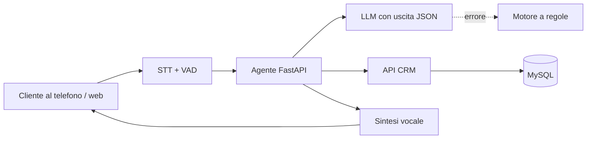

# 📞 Sara — Assistente vocale per il customer care energia

> Un'assistente vocale che riconosce il cliente, legge bollette, contratti e pratiche dal CRM e apre ticket in autonomia.

**Contesto:** realizzato per un operatore italiano del mercato libero luce e gas (nome omesso per riservatezza) · **Ruolo:** analisi, progettazione e sviluppo · **Codice:** privato

---

## Il problema
Il customer care riceve ogni giorno le stesse domande: stato della bolletta, pagamenti, avanzamento delle pratiche. Ogni chiamata richiede di cercare il cliente in più schermate.

## La soluzione
- **Identificazione del cliente** da nome, telefono o codice cliente.
- **Risposte sui dati reali**: bollette pagate e insolute, contratti, pratiche attive, consumi con grafici.
- **Apertura ticket** direttamente nel CRM e trasferimento all'operatore quando serve.
- **LLM con uscita strutturata (JSON)**: il modello restituisce sia il parlato sia le azioni da mostrare a schermo.
- **Fallback robusto**: se il modello non risponde subentra un motore a regole; funziona sia con un LLM cloud sia con un LLM locale.
- Canale **telefonico VoIP** e dashboard web con voce nel browser; ampia suite di test e simulazioni di chiamata (anche con cliente arrabbiato).

## Architettura (semplificata)

## Stack
| Livello | Tecnologie |
|---|---|
| Backend | Python, FastAPI |
| Voce | pyVoIP, webrtcvad, Whisper / faster-whisper, TTS cloud, SSML |
| AI | LLM cloud gestito oppure Ollama in locale, fallback a regole |
| CRM | API REST PHP + MySQL |
| Esercizio | systemd, script di deploy e diagnostica |

---
### Perché il codice non è pubblico
Il software è in uso in azienda e tratta dati di clienti reali: codice, configurazioni e dati restano privati.
Questa pagina descrive cosa fa e come è costruito. Demo con **dati fittizi** su appuntamento; codice visionabile in **screen-share** o dopo **NDA**.

**Vuoi una soluzione simile per la tua azienda?** Scrivimi: analizzo il processo e propongo una versione su misura.

**Contatti:** [gasparepettinati.it](https://gasparepettinati.it) · info@gasparepettinati.it

© 2026 Gaspare Pettinati — Tutti i diritti riservati. Vedi [LICENSE](LICENSE).
