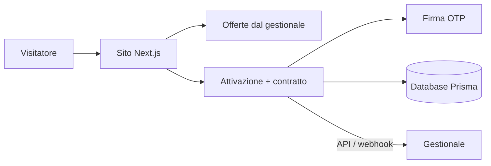

# 🧾 Sito offerte e attivazione contratti online

> Dal confronto delle offerte alla firma del contratto, online e senza carta, con i dati che arrivano direttamente nel gestionale.

**Contesto:** realizzato per un operatore italiano del mercato libero luce e gas (nome omesso per riservatezza) · **Ruolo:** analisi, progettazione e sviluppo · **Codice:** privato

---

## Il problema
Un cliente che sceglie un'offerta online spesso deve poi ricevere una chiamata, compilare moduli e rispedire documenti. Ogni passaggio manuale è un cliente perso.

## La soluzione
- **Vetrina delle offerte** luce, gas e dual con schede di dettaglio, aggiornate dal gestionale.
- **Percorso di attivazione** per clienti domestici e business, con contratto generato in automatico.
- **Firma elettronica OTP** del contratto ed email di conferma con i documenti.
- **Invio al gestionale** dei contratti e delle richieste di ricontatto tramite API e webhook.
- Pagine legali, cookie banner, SEO tecnica (sitemap, robots), checklist di deploy e rollback.

## Architettura (semplificata)

## Stack
| Livello | Tecnologie |
|---|---|
| Frontend | Next.js, React, TypeScript |
| Dati | Prisma ORM |
| Backend | Node.js, Express, Helmet, Nodemailer |
| Esercizio | Docker Compose, checklist di deploy |

---
### Perché il codice non è pubblico
Il software è in uso in azienda e tratta dati di clienti reali: codice, configurazioni e dati restano privati.
Questa pagina descrive cosa fa e come è costruito. Demo con **dati fittizi** su appuntamento; codice visionabile in **screen-share** o dopo **NDA**.

**Vuoi una soluzione simile per la tua azienda?** Scrivimi: analizzo il processo e propongo una versione su misura.

**Contatti:** [gasparepettinati.it](https://gasparepettinati.it) · info@gasparepettinati.it

© 2026 Gaspare Pettinati — Tutti i diritti riservati. Vedi [LICENSE](LICENSE).
