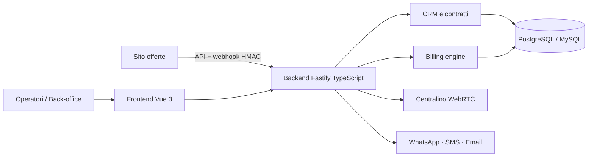

# ⚡ ERPCRM Energy — Suite gestionale per venditori di luce e gas

> CRM, back-office, fatturazione e call center in un'unica piattaforma per il mercato libero dell'energia.

**Contesto:** realizzato per un operatore italiano del mercato libero luce e gas (nome omesso per riservatezza) · **Ruolo:** analisi, progettazione e sviluppo · **Codice:** privato

---

## Il problema
Chi vende energia sul mercato libero lavora con strumenti separati: un CRM per i clienti, fogli Excel per le pratiche, un software per il call center, un altro per la fatturazione. I dati si duplicano e gli adempimenti ARERA diventano un lavoro manuale.

## La soluzione
- **Scheda cliente 360°**: anagrafica, forniture (POD/PDR), contratti, documenti, interazioni e pagamenti in un'unica vista.
- **Centralino e liste di contatto** con softphone WebRTC integrato.
- **Back-office**: gestione pratiche, flussi verso il Sistema Informativo Integrato e archivio XML luce/gas.
- **Billing engine** con calcolo delle voci della bolletta e controlli prima della fatturazione.
- **Credito e morosità**, tesoreria e banche, listini e offerte commerciali.
- **Comunicazioni**: WhatsApp, SMS ed email dal gestionale; area clienti online.
- **API per il sito web**: le offerte pubblicate e i contratti firmati online arrivano direttamente nel gestionale (webhook firmati HMAC).
- Ruoli e permessi, **audit log** delle attività, validazione di codice fiscale e partita IVA.

## Architettura (semplificata)

## Stack
| Livello | Tecnologie |
|---|---|
| Frontend | Vue 3, Vite, TypeScript, Pinia |
| Backend | Node.js + Fastify (TypeScript), moduli PHP |
| Dati | PostgreSQL, MySQL, export Excel |
| Integrazioni | Twilio, WhatsApp, webhook HMAC verso il sito offerte |
| Infrastruttura | Docker, script di deploy, build Android |

---
### Perché il codice non è pubblico
Il software è in uso in azienda e tratta dati di clienti reali: codice, configurazioni e dati restano privati.
Questa pagina descrive cosa fa e come è costruito. Demo con **dati fittizi** su appuntamento; codice visionabile in **screen-share** o dopo **NDA**.

**Vuoi una soluzione simile per la tua azienda?** Scrivimi: analizzo il processo e propongo una versione su misura.

**Contatti:** [gasparepettinati.it](https://gasparepettinati.it) · info@gasparepettinati.it

© 2026 Gaspare Pettinati — Tutti i diritti riservati. Vedi [LICENSE](LICENSE).
