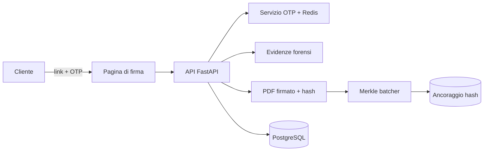

# ✍️ Firma elettronica OTP con prove forensi

> Firma dei contratti via SMS/OTP con raccolta delle evidenze e ancoraggio crittografico degli hash.

**Contesto:** realizzato per un operatore italiano del mercato libero luce e gas (nome omesso per riservatezza) · **Ruolo:** analisi, progettazione e sviluppo · **Codice:** privato

---

## Il problema
Far firmare un contratto a distanza deve essere semplice per il cliente ma solido come prova: chi ha firmato, quando, da quale dispositivo, e che il documento non sia stato alterato.

## La soluzione
- **Sessioni di firma con OTP** inviato via SMS ed email, con instradamento delle notifiche.
- **Raccolta delle evidenze**: IP, dispositivo, user agent e geolocalizzazione approssimativa tramite middleware dedicato.
- **PDF firmati e sigillati** con generazione del documento e hash.
- **Ancoraggio degli hash** raggruppati in un Merkle tree: si può dimostrare in seguito che il documento non è cambiato.
- Pannello operatore in Next.js: contratti, ispezione del dispositivo, stato del sistema.
- Test su crittografia, PDF, forensics e notifiche.

## Architettura (semplificata)

## Stack
| Livello | Tecnologie |
|---|---|
| Backend | Python, FastAPI, Pydantic, PyJWT |
| Sicurezza | cryptography, OTP, Redis, analisi user agent / GeoIP |
| Documenti | pypdf, ReportLab |
| Frontend | Next.js, React, Tailwind |
| Integrità | Merkle tree, web3 |

---
### Perché il codice non è pubblico
Il software è in uso in azienda e tratta dati di clienti reali: codice, configurazioni e dati restano privati.
Questa pagina descrive cosa fa e come è costruito. Demo con **dati fittizi** su appuntamento; codice visionabile in **screen-share** o dopo **NDA**.

**Vuoi una soluzione simile per la tua azienda?** Scrivimi: analizzo il processo e propongo una versione su misura.

**Contatti:** [gasparepettinati.it](https://gasparepettinati.it) · info@gasparepettinati.it

© 2026 Gaspare Pettinati — Tutti i diritti riservati. Vedi [LICENSE](LICENSE).
