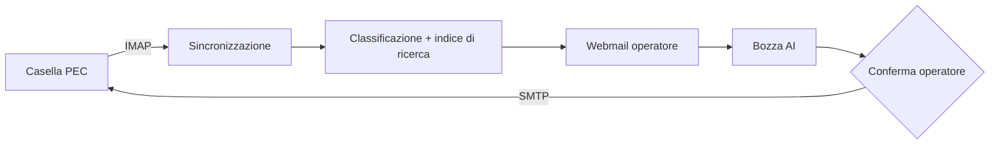

# 📨 PEC Assistant — webmail PEC con assistente AI

> Legge la casella PEC aziendale, classifica i messaggi e prepara le risposte con l'AI. Nulla parte senza conferma.

**Contesto:** realizzato per un operatore italiano del mercato libero luce e gas (nome omesso per riservatezza) · **Ruolo:** analisi, progettazione e sviluppo · **Codice:** privato

---

## Il problema
La PEC aziendale riceve reclami, richieste e comunicazioni ufficiali mescolate a ricevute tecniche. Smistarle e rispondere a mano richiede ore, e un errore può avere conseguenze legali.

## La soluzione
- **Webmail PEC** collegata via IMAP/SMTP al gestore, senza toccare lo stato letto/non letto in Outlook.
- **Esclusione automatica** delle ricevute tecniche; **classificazione** e **ricerca** full-text dei messaggi.
- **Bozze di risposta con AI** basate su istruzioni aziendali ed esempi approvati, con soglia di confidenza.
- **Revisione umana obbligatoria** per i casi legali, contrattuali, economici o con dati personali: si invia solo dopo conferma.
- **Risposte automatiche programmate** (es. ferie) con modalità di simulazione.
- Utenti, ruoli, audit log, backup e report; test automatici.

## Architettura (semplificata)

## Stack
| Livello | Tecnologie |
|---|---|
| Backend | Node.js, TypeScript, Express, Zod, Pino |
| Posta | ImapFlow, mailparser, Nodemailer |
| AI | LLM via API o Ollama in locale |
| Esercizio | Docker, Plesk, avvio automatico su Windows |

---
### Perché il codice non è pubblico
Il software è in uso in azienda e tratta dati di clienti reali: codice, configurazioni e dati restano privati.
Questa pagina descrive cosa fa e come è costruito. Demo con **dati fittizi** su appuntamento; codice visionabile in **screen-share** o dopo **NDA**.

**Vuoi una soluzione simile per la tua azienda?** Scrivimi: analizzo il processo e propongo una versione su misura.

**Contatti:** [gasparepettinati.it](https://gasparepettinati.it) · info@gasparepettinati.it

© 2026 Gaspare Pettinati — Tutti i diritti riservati. Vedi [LICENSE](LICENSE).
