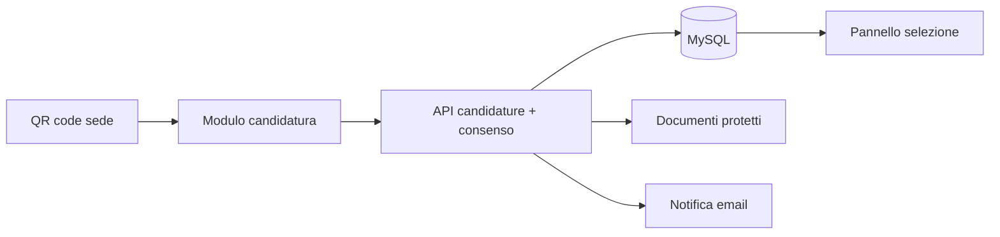

# 🧑‍💼 Portale candidature e selezione del personale

> Candidature online con documenti, consensi privacy e QR code per le sedi, e un pannello per gestirle.

**Contesto:** realizzato per un operatore italiano del mercato libero luce e gas (nome omesso per riservatezza) · **Ruolo:** analisi, progettazione e sviluppo · **Codice:** privato

---

## Il problema
Le candidature arrivano da email, messaggi e moduli cartacei: CV persi, consensi privacy non tracciati, nessuna visione d'insieme per chi seleziona.

## La soluzione
- **Modulo di candidatura online** con caricamento dei documenti e **consenso privacy** registrato.
- **QR code per sede o campagna**: il candidato arriva al modulo già precompilato.
- **Pannello di selezione**: elenco, filtri, gruppi, scheda candidato e download protetto dei documenti.
- Notifiche email, gestione delle candidature ripetute, cambio password e accesso riservato.
- Privacy e cookie policy integrate.

## Architettura (semplificata)

## Stack
| Livello | Tecnologie |
|---|---|
| Applicazione | PHP |
| Dati | MySQL |
| Integrazioni | PHPMailer, generazione QR code |

---
### Perché il codice non è pubblico
Il software è in uso in azienda e tratta dati di clienti reali: codice, configurazioni e dati restano privati.
Questa pagina descrive cosa fa e come è costruito. Demo con **dati fittizi** su appuntamento; codice visionabile in **screen-share** o dopo **NDA**.

**Vuoi una soluzione simile per la tua azienda?** Scrivimi: analizzo il processo e propongo una versione su misura.

**Contatti:** [gasparepettinati.it](https://gasparepettinati.it) · info@gasparepettinati.it

© 2026 Gaspare Pettinati — Tutti i diritti riservati. Vedi [LICENSE](LICENSE).
