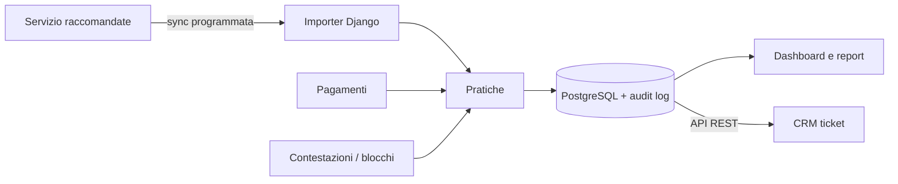

# 📮 Monitor raccomandate — preavvisi, pagamenti e contestazioni

> Traccia le raccomandate di preavviso, i pagamenti e le contestazioni con uno storico che non si cancella mai.

**Contesto:** realizzato per un operatore italiano del mercato libero luce e gas (nome omesso per riservatezza) · **Ruolo:** analisi, progettazione e sviluppo · **Codice:** privato

---

## Il problema
Le pratiche di preavviso per morosità richiedono tempi precisi e prove documentali: date di invio e consegna della raccomandata, pagamenti arrivati nel frattempo, reclami che bloccano la procedura.

## La soluzione
- **Sincronizzazione automatica** con il servizio di raccomandata elettronica: stato, date, esito postale, PDF e ricevute.
- **Pratiche** con decorrenza dei termini, priorità, operatore assegnato e verifiche di conformità.
- **Pagamenti**, **contestazioni** e **blocchi** cautelativi collegati alla pratica.
- **Nessuna cancellazione distruttiva**: archiviazione e audit log di ogni cambio di stato.
- Dashboard con archivio storico per anno e mese, analisi ed esportazioni.
- **API REST** per l'integrazione con il CRM dei ticket.

## Architettura (semplificata)

## Stack
| Livello | Tecnologie |
|---|---|
| Applicazione | Python, Django, Gunicorn, WhiteNoise |
| Dati | PostgreSQL |
| Integrazioni | Sincronizzazione HTTP, lettura PDF |
| Esercizio | Comandi di gestione e worker programmati |

---
### Perché il codice non è pubblico
Il software è in uso in azienda e tratta dati di clienti reali: codice, configurazioni e dati restano privati.
Questa pagina descrive cosa fa e come è costruito. Demo con **dati fittizi** su appuntamento; codice visionabile in **screen-share** o dopo **NDA**.

**Vuoi una soluzione simile per la tua azienda?** Scrivimi: analizzo il processo e propongo una versione su misura.

**Contatti:** [gasparepettinati.it](https://gasparepettinati.it) · info@gasparepettinati.it

© 2026 Gaspare Pettinati — Tutti i diritti riservati. Vedi [LICENSE](LICENSE).
