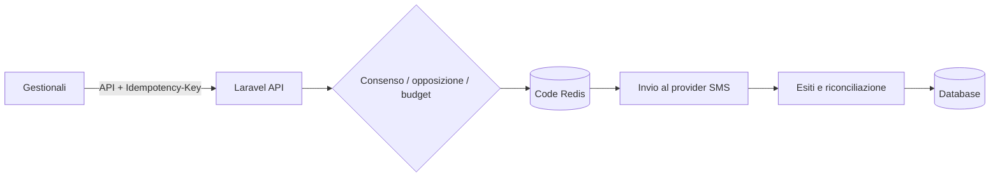

# 💬 SMS Box — gateway SMS con consensi e controllo dei costi

> Invii SMS transazionali e campagne con gestione dei consensi, idempotenza e budget sotto controllo.

**Contesto:** realizzato per un operatore italiano del mercato libero luce e gas (nome omesso per riservatezza) · **Ruolo:** analisi, progettazione e sviluppo · **Codice:** privato

---

## Il problema
Mandare SMS dai gestionali aziendali sembra semplice, ma servono garanzie: niente doppi invii, rispetto delle opposizioni, costi prevedibili e stato reale di consegna.

## La soluzione
- **API interne** per contatti, preventivi e messaggi con chiave di **idempotenza** obbligatoria.
- **Campagne** programmate con esclusioni.
- **Consensi e opposizioni**: chi ha detto no non riceve più messaggi.
- **Budget e registro dei costi** per evitare sorprese in fattura.
- Code di lavoro per invio, polling degli esiti, **riconciliazione degli esiti incerti**, scadenza e pulizia dei dati.
- Autenticazione a due fattori, ruoli e audit log.

## Architettura (semplificata)

## Stack
| Livello | Tecnologie |
|---|---|
| Applicazione | PHP, Laravel, Livewire, Sanctum |
| Code | Redis, job pianificati |
| Sicurezza | Google2FA, ruoli, audit log |
| Esercizio | Docker Compose |

---
### Perché il codice non è pubblico
Il software è in uso in azienda e tratta dati di clienti reali: codice, configurazioni e dati restano privati.
Questa pagina descrive cosa fa e come è costruito. Demo con **dati fittizi** su appuntamento; codice visionabile in **screen-share** o dopo **NDA**.

**Vuoi una soluzione simile per la tua azienda?** Scrivimi: analizzo il processo e propongo una versione su misura.

**Contatti:** [gasparepettinati.it](https://gasparepettinati.it) · info@gasparepettinati.it

© 2026 Gaspare Pettinati — Tutti i diritti riservati. Vedi [LICENSE](LICENSE).
