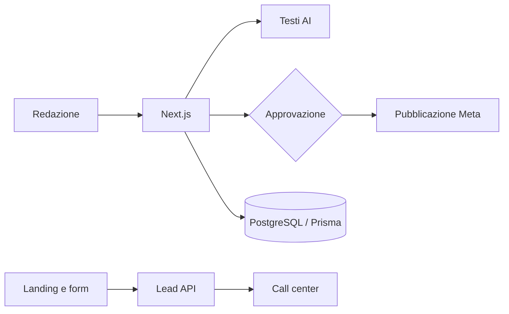

# 📣 Piattaforma social e lead multi-account

> Pianifica, approva e pubblica contenuti su Facebook e Instagram con l'AI, e raccoglie i lead delle campagne.

**Contesto:** realizzato per un operatore italiano del mercato libero luce e gas (nome omesso per riservatezza) · **Ruolo:** analisi, progettazione e sviluppo · **Codice:** privato

---

## Il problema
Le aziende che fanno marketing sui social perdono tempo tra calendario editoriale, approvazioni via chat, pubblicazione manuale e lead dispersi tra piattaforme diverse.

## La soluzione
- **Calendario editoriale** e **flusso di approvazione** dei contenuti.
- **Testi suggeriti dall'AI** (modello Qwen) da rivedere prima della pubblicazione.
- **Pubblicazione su Facebook e Instagram** tramite Meta OAuth: nessuna password social salvata.
- **Raccolta lead** da form e API, integrazione con il software del call center e Google Ads.
- **Multi-account e white-label**, con dominio personalizzato per le landing.
- Credenziali cifrate, ruoli e test automatici (Vitest).

## Architettura (semplificata)

## Stack
| Livello | Tecnologie |
|---|---|
| Applicazione | Next.js, React, TypeScript, Tailwind, Zod |
| Dati | PostgreSQL, Prisma |
| Integrazioni | Meta Graph API (OAuth), Google Ads, webhook call center |
| Esercizio | Docker, Caddy |

---
### Perché il codice non è pubblico
Il software è in uso in azienda e tratta dati di clienti reali: codice, configurazioni e dati restano privati.
Questa pagina descrive cosa fa e come è costruito. Demo con **dati fittizi** su appuntamento; codice visionabile in **screen-share** o dopo **NDA**.

**Vuoi una soluzione simile per la tua azienda?** Scrivimi: analizzo il processo e propongo una versione su misura.

**Contatti:** [gasparepettinati.it](https://gasparepettinati.it) · info@gasparepettinati.it

© 2026 Gaspare Pettinati — Tutti i diritti riservati. Vedi [LICENSE](LICENSE).
